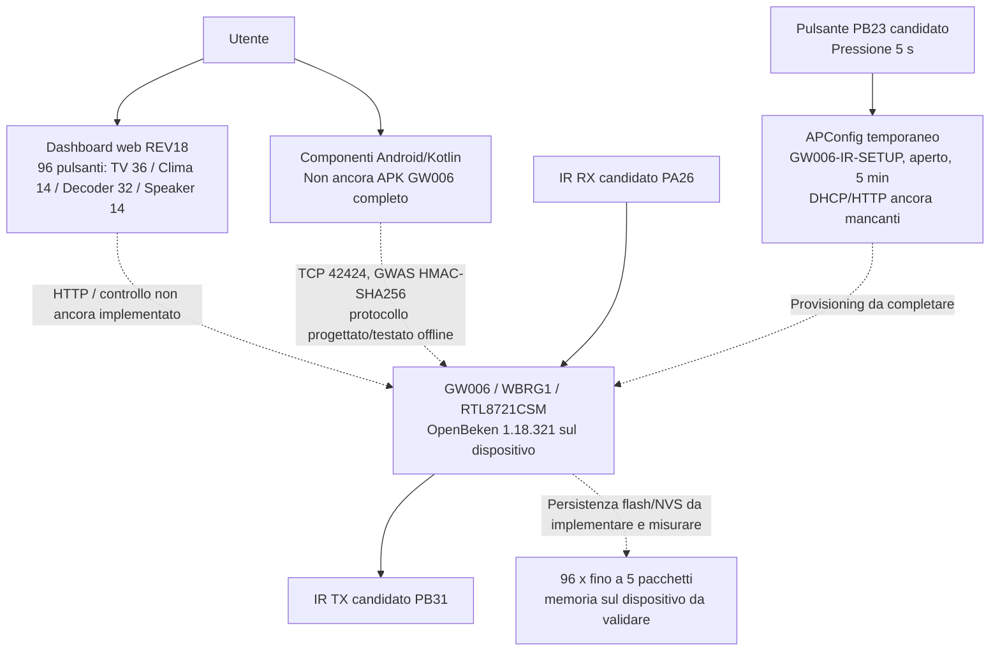

# GW006 IR Universal — Schema di riferimento REV18
Data: 11 novembre 2026 | Stato: **progetto e test software; NON pronto da flashare**

## A. Architettura funzionale



**Attenzione:** linee tratteggiate = interfacce richieste/progettate ma non ancora operative sulla scheda. Dashboard REV18 è una demo HTML offline; non controlla l'hardware.

## B. Mappa pin candidata — da verificare prima di collegare / usare

| Segnale | GPIO WBRG1 | Contatto / collegamento rilevato | Stato |
|---|---|---|---|
| IR TX | **PB31** | Contatto modulo **20** (AOUTP_L) | Libero secondo verifica multimetro a scheda spenta; pinmux e TX fisico ancora da collaudare |
| IR RX | **PA26** | Contatto modulo **11** (REQ) → **P2 prima piazzola in alto** | Continuità/assenza altri carichi riferite; acquisizione fisica da collaudare |
| LED rosso | PA25 | Circuito LED rosso esistente | **Riservato**, non usare per IR |
| LED blu | PB22 | Circuito LED blu esistente | **Riservato**, non usare per IR |
| Pulsante | PB23 | Pulsante PCB esistente | **Riservato**, identificazione elettrica ancora da convalidare |
| GND, +3,3 V | Da definire sui punti già verificati | Nessuna assegnazione inventata | **Misurare** prima dell'alimentazione dei componenti esterni |
| +5 V | Non confermato | N/D | **Non collegare** |

**Nota cruciale:** vecchia ipotesi PA18/PA19 sulle piazzole ex ZS3L **superata** per la REV18. Non usare le vecchie piazzole RX/TX come collegamento pronto all'uso. Il pinmux di PB31 e PA26 presenta incoerenze tra nota applicativa e sample SDK (vedi `docs/REV18_BOARD_PINS_DASHBOARD.md` nell'archivio locale); l'hardware IR resta volutamente disabilitato nel codice.

## C. Comandi e funzioni

| Funzione | Specifica | Implementazione verificata |
|---|---|---|
| Telecomandi | TV 36, Clima 14, Decoder 32, Speaker 14 = **96 tasti** | Dashboard HTML interattiva **solo offline** |
| Tasto breve | Invia codice IR | Non connesso a hardware |
| Pressione lunga 3 s | Acquisisci / prova / salva / elimina | Menu visivo, senza salvataggio reale |
| Codici | Fino a **5 pacchetti IR per tasto** | Motore e formati testati software; flash/NVS da completare |
| Wi-Fi STA | DHCP o IPv4 statico | Parser e validazione offline |
| APConfig | Pulsante 5 s, AP aperto per 5 min, no login, SSID GW006-IR-SETUP | FSM e adapter SDK; **server DHCP/HTTP non operativo** |
| Comandi IR LAN | TCP **42424**, HMAC-SHA256 anti-replay | Protocollo e test offline; **listener reale non operativo** |
| MQTT | Solo Home Assistant, opzionale | Interfaccia grafica; non integrato nel dispositivo |
| DuckDNS | Configurazione prevista | Interfaccia grafica; non funzionante sul dispositivo |

## D. Schema a blocchi elettrico (NON cablaggio esecutivo)

```text
       GW006 / WBRG1 — RTL8721CSM
       ┌────────────────────────────────────────────────────┐
       │ PB31 (contatto modulo 20) - candidato IR TX        ├─ - - > [driver LED IR da progettare/verificare] -> LED IR
       │ PA26 (contatto modulo 11) - candidato IR RX        ◄─ - - - [ricevitore IR 3,3 V, alimentazione da verificare]
       │ PB23 - pulsante PCB esistente (APConfig)           │
       │ PA25 / PB22 - LED già occupati                     │
       │ 3,3 V / GND - solo punti verificati col tester      │
       └────────────────────────────────────────────────────┘
       - - - = collegamento previsto, NON testato e NON istruzione di saldatura
```

Non collegare direttamente LED IR a una GPIO senza dimensionamento di corrente, driver adeguato e verifica tensioni. Non applicare 5 V ai pin del Realtek.

## E. Stato e prossimo passaggio

- Firmware sul dispositivo: **OpenBeken 1.18.321** da preservare.
- REV18: sorgenti locali, host test, Kotlin test, ARM smoke e asset web test presenti; **nessun file firmware GW006 installabile qualificato**.
- Prima di un flash: convalida pinmux, alimentazioni e IR TX/RX reali; backup leggibile e procedura di ripristino; boot/partizioni; servizio Wi-Fi/HTTP/TCP; persistenza 96×5 e analisi di capienza; prove su hardware.
- Sorgenti di riferimento del checkpoint: `GW006_IR_NATIVE_V2_REV18/docs/REV18_BOARD_PINS_DASHBOARD.md`, `GW006_IR_NATIVE_V2_REV18/README.md`, `CHECKPOINT_GW006_IR_UNIVERSAL_CP07_2026-11-11.md`.

**Il presente schema non autorizza cablaggio definitivo o flash del dispositivo.**
